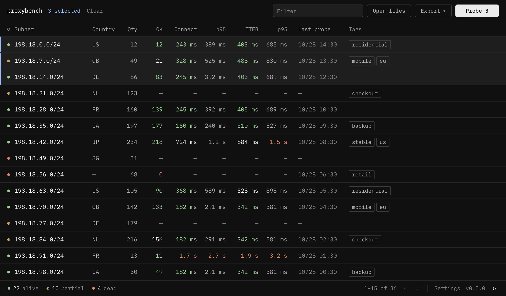

  
  <h1>proxybench</h1>
  

    Keep HTTP proxy lists organised by subnet, see which <code>/24</code>s are
    alive, and measure how quickly each one connects and answers.
  

  

  <a href="#install">Install</a>
  ·
  <a href="#use">Use</a>
  ·
  <a href="#settings">Settings</a>
  ·
  <a href="#what-the-numbers-mean">Numbers</a>

  

## What it does

proxybench is a small desktop app. Drop a list of HTTP proxies and get one row
per IPv4 `/24`. A quick **Check** tells you which subnets are alive every time
you open the app or import a list. A full **Probe** measures Connect and TTFB
through every proxy. Export the lists you want to keep.

It does not judge whether a site accepted the request. A `200` and a `403`
are both a valid speed sample: headers arrived. Response bodies are never
read.

## Install

You do not need Git, GitHub, or a developer setup.

1. Open the [latest release](https://github.com/Mathious6/proxybench/releases/latest).
2. Download the file for your computer.

| Your computer                           | File to download             |
| --------------------------------------- | ---------------------------- |
| Mac with Apple Silicon (M1, M2, M3, M4) | macOS **arm64** `.dmg`       |
| Mac with Intel                          | macOS **x64** `.dmg`         |
| Windows 10 or 11                        | Windows **x64** setup `.exe` |

On a Mac, open the DMG, drag **proxybench** into Applications, then open it
normally. macOS builds are Developer ID signed and notarized by Apple.

On Windows, run the setup wizard. If SmartScreen appears, choose **More
info**, then **Run anyway**. Windows needs WebView2; Windows 10 and 11
usually already have it. Windows installers are unsigned.

## Use

1. Drop `.txt` files or a folder onto the window, or click **Open files**.
   One HTTP proxy per line, `host:port:username:password`, for example
   `192.0.2.10:8080:user:pass`. Blank lines and `#` comments are ignored;
   anything else is skipped and counted. New `/24`s are added and existing
   ones gain any new lines. Imported lines, including credentials, are stored
   unencrypted in the app's local data directory.
2. Each `/24` gets a status dot. On launch and after every import, proxybench
   checks a few proxies per subnet: a solid green dot means alive, a half
   ring means some failed, red means none answered, an empty ring means not
   checked yet. Click the counts in the bottom bar to show only those rows.
3. Country is looked up in batches through [country.is](https://country.is),
   from one listed IP per subnet, and refreshed before every Probe.
4. Tag subnets if you want. Tags are stored on this computer by subnet and
   survive the next import. Click a column header to sort, type in
   **Filter** to match subnet, country, or tag.
5. Select rows with a click. Command-click on macOS or Ctrl-click on Windows
   toggles rows, Shift-click selects a range across pages, Command/Ctrl-A
   selects every filtered row, and Escape clears the selection. Probe,
   Export, and the right-click menu act on the selection when there is one.
6. **Probe** measures every proxy of the selected subnets, or all of them.
   Progress and **Stop** sit in the bottom bar; stopping keeps what was
   measured. Results survive a restart. Adding proxies to a `/24` clears its
   status and timings.
7. **Export** writes one `.txt` per subnet with the source lines verbatim,
   named `[{tags}_]{CC}_{IP}_24_{qty}.txt`, for example
   `isp-mobile_FR_192.0.2.0_24_42.txt`. No tags means the name starts with the
   country code; no country means `XX`. Several subnets at once produce one
   `.zip` with every subnet's file plus `ALL_<qty>.txt` holding every line.
   **AYCD JSON** writes one categorized file for the same scope.
8. **Remove** in the right-click menu deletes the selected subnets, or the
   one you clicked.

Keyboard: Command/Ctrl-O opens files, Command/Ctrl-F focuses the filter, and
Command/Ctrl-comma opens Settings.

Run a probe once, then pause. Back-to-back runs saturate your own uplink
and inflate every subnet.

## Settings

| Setting        | Default | What it does                                                            |
| -------------- | ------- | ----------------------------------------------------------------------- |
| Target URL     | a lightweight public endpoint | The one HTTPS target used by Check and Probe.    |
| Timeout        | 5 s     | A proxy slower than this counts as failed.                              |
| In flight      | 128     | Most proxies tested at the same time.                                   |
| Start rate     | 20 /s   | Most new connections opened per second.                                 |
| Check on launch and after import | on | Runs the quick Check automatically.                  |
| Sample         | 2       | Proxies the Check tries in each subnet.                                 |

Check only asks each sampled proxy to open a tunnel to the target. Probe goes
all the way to the target's response headers.

## What the numbers mean

| Column     | Meaning                                                                                      |
| ---------- | -------------------------------------------------------------------------------------------- |
| Qty        | Proxies imported in that `/24`.                                                              |
| OK         | Probes that returned origin headers within the timeout.                                      |
| Connect    | Time from dialing the proxy until HTTP CONNECT returns `200` (tunnel up, before origin TLS). |
| TTFB       | Time from that same start until origin HTTPS headers arrive.                                 |
| p95        | The slower end: 95% of successful probes were at least this fast.                            |
| Last probe | When that `/24` last finished a Probe.                                                       |

Each probe uses a fresh TCP connection. Reuse would zero Connect. Failures
are left out of the timings and counted against OK.

Timings show milliseconds, or seconds above one second. A median under
500 ms is green; anything over 1500 ms is red. OK is green at 80% success and
red below 30%. Colour is emphasis, not a score.

## Not this tool

- Not a bypass tester, quality score, or anti-bot oracle.
- Not SOCKS, not proxy URLs, not hostnames or IPv6, not extra line formats.
- Not a multi-target lab. One URL per run.
- Does not download bodies. Does not report status codes or error types.

## License

MIT. The bundled IBM Plex Mono font is under the SIL Open Font License.
